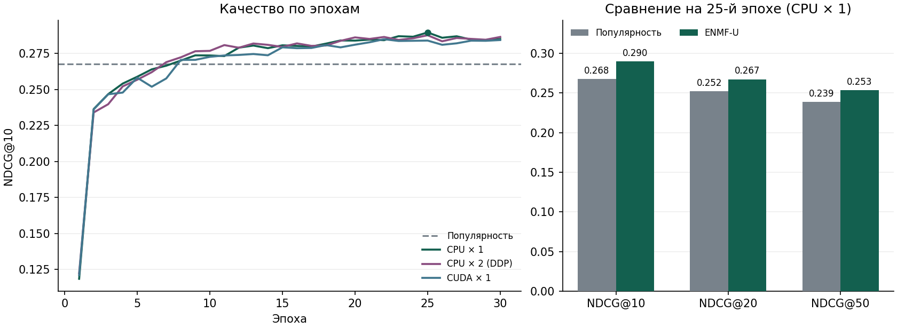

# Рекомендации фильмов с ENMF-U

Модель на PyTorch учится по истории оценок MovieLens 1M и подбирает фильмы, которые пользователь ещё не оценивал. Для обучения учитывается весь каталог, поэтому отрицательные примеры не нужно сэмплировать.

На временной валидации ENMF-U набрал **0,2897 по NDCG@10**. У рекомендаций по популярности получилось **0,2676**. Это прирост на **8,25%**. Разбиение, параметры и результаты всех запусков есть в [отчёте](REPORT.md).



## Запуск

Из корня проекта выполните команды в окружении с Python 3.11 или новее. Для запуска на GPU нужна сборка PyTorch с CUDA. [Установка PyTorch](https://pytorch.org/get-started/locally/)

```powershell
python -m pip install -r requirements.txt
python -m enmf download
python -m enmf train --output runs/cpu-1
```

`download` скачивает MovieLens 1M в `data/ml-1m.zip` и сверяет SHA-256. Можно положить туда скачанный архив. [Датасет и условия использования](https://grouplens.org/datasets/movielens/1m/)

У каждого запуска своя папка с `metrics.json`, событиями TensorBoard и `best.pt`. В чекпойнте лежат веса лучшей эпохи, исходные ID и история обучения. Если `runs/cpu-1/best.pt` уже есть, можно сразу запросить пять рекомендаций для пользователя `635`.

```powershell
python -m enmf recommend --checkpoint runs/cpu-1/best.pt --user-id 635 --top-k 5
```

При повторном обучении задайте новую папку через `--output`. Параметры можно переопределить своим файлом через `--config`. [Конфигурация по умолчанию](configs/movielens.json)

Чтобы посмотреть кривые обучения, запустите TensorBoard, откройте `http://localhost:6006` и выберите **Scalars**.

```powershell
python -m tensorboard.main --logdir runs
```

## DDP и CUDA

На Windows проверены DDP на двух CPU-процессах с Gloo и обучение на одной видеокарте.

```powershell
python -m enmf.launch --processes 2 train --output runs/cpu-ddp-2
python -m enmf train --device cuda --output runs/cuda-1
```

`batch_size` задаёт общий размер батча. Для DDP на GPU каждому процессу нужна отдельная видимая видеокарта. Команда ниже рассчитана на Linux с NCCL.

```bash
python -m enmf.launch --processes 2 train --device cuda --output runs/cuda-ddp-2
```

## Ноутбук и тесты

```powershell
python -m pip install -r requirements-notebook.txt
python -m jupyterlab notebooks/demo.ipynb
```

В JupyterLab выберите **Run → Run All Cells**. На маленьком примере можно проверить формулу потерь, а графики строятся по JSON из `results/`. Для последней ячейки с названиями фильмов нужны `data/ml-1m.zip` и `runs/cpu-1/best.pt`. [Ноутбук](notebooks/demo.ipynb)

```powershell
python -m unittest discover -s tests -v
```

[Подготовка данных](enmf/data.py) · [Модель и функция потерь](enmf/model.py) · [Обучение](enmf/training.py) · [Популярность и NDCG](enmf/ranking.py) · [Рекомендации](enmf/recommend.py)
